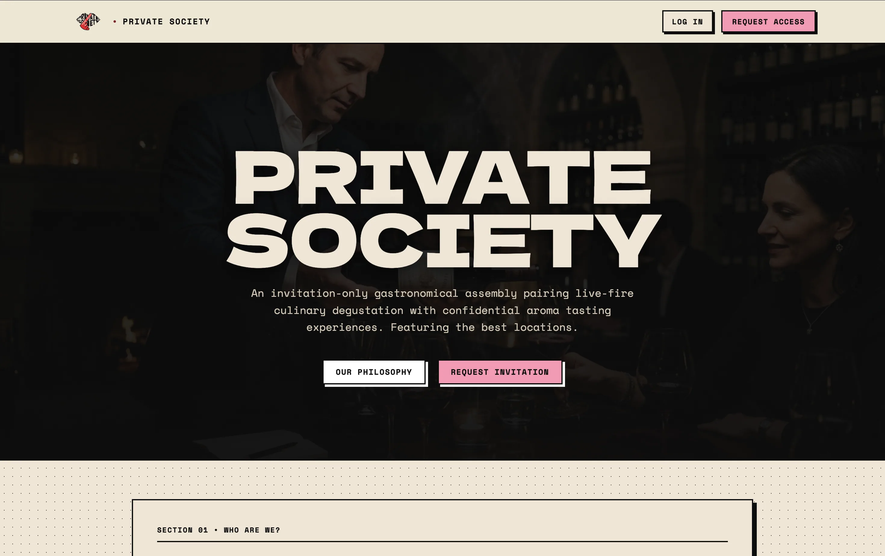
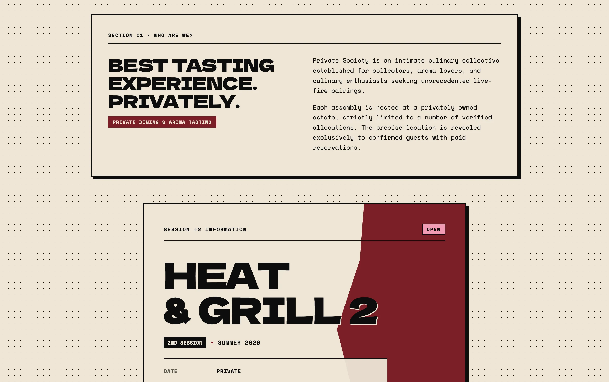
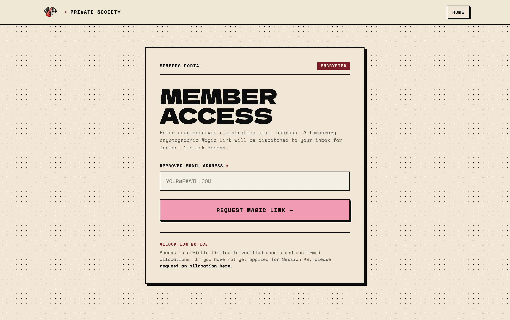
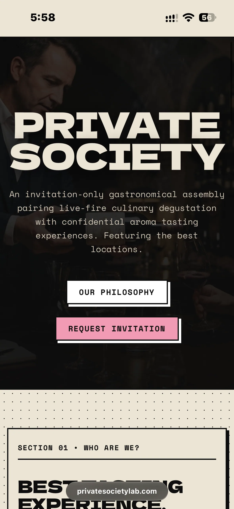
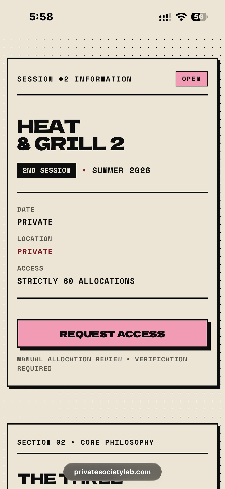
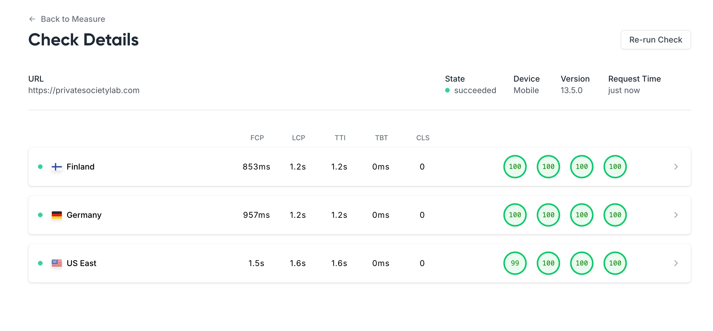

# privatesocietylab.com (Private Society Lab) — Architectural Case Study

> **Notice on Proprietary Code & NDA Compliance:**  
> This website was designed and built as a commercial deliverable for a paying client.  
> To protect client intellectual property, copyrighted assets, and proprietary brand designs,  
> the production source repository remains private. This repository serves as an architectural  
> breakdown, responsive UI review, and web performance case study.

[🔗 Visit Live Website](https://privatesocietylab.com) · [📐 System Architecture](architecture.md) · [👤 Return to Portfolio](https://sehnalik.com)

---

  

---

## Overview & Scope

| Attribute | Specification |
| :--- | :--- |
| **Site Type** | Invitation-Only Culinary Collective & Experiential Member Portal |
| **Status** | Live in Production |
| **Runtime Topology** | Edge-First SSR + Static Assets (Cloudflare Workers Runtime) |
| **Frontend Stack** | Astro v7 / Tailwind CSS v4 (LightningCSS) / Vanilla TypeScript |
| **Data & Storage** | Cloudflare D1 (SQLite) / Cloudflare R2 Bucket (`privatesociety-assets`) |
| **CMS & Mail Engine** | Embedded KideCMS Runtime / Resend Transactional Mail API |
| **Architecture Specification** | Fully unified master document in [`architecture.md`](architecture.md) |

---

## Visual Showcase & Interface Gallery

Private Society implements a **Neo-Brutalist Archival Dispatch** aesthetic across all viewports, pairing high-contrast typography (`Dela Gothic One` & `Space Mono`) with tactile offset drop shadows and warm archival paper textures.

### Desktop Experience

  
  <em>Curation Philosophy & Assembly Briefing — Session scheduling, live-fire culinary principles, and pillar archive.</em>

  
  <em>Encrypted Member Portal (/portal) — Gated access with tasting flight cards, timeline schedules, and QR payment tier selection.</em>

### Mobile-First Responsive Engineering

Strict aspect-ratio containers, fluid clamp typography, and zero-framework scripts guarantee zero Cumulative Layout Shift (CLS $\le$ 0.02) and instantaneous touch response on mobile viewports.

| Mobile Hero & Navigation | Mobile Session Briefing & Admission |
| :---: | :---: |
|  |  |

---

## Core Web Vitals & Real Performance Audits

  

Audited via **Lighthouse 13.5.0** (Desktop) across multi-region edge testing nodes:

| Test Location | Performance | Accessibility | Best Practices | SEO | FCP | LCP | TTI | TBT | CLS |
| :--- | :---: | :---: | :---: | :---: | :---: | :---: | :---: | :---: | :---: |
| **Germany** | **100** | **100** | **100** | **100** | 306ms | 346ms | 346ms | 0ms | 0.02 |
| **Finland** | **100** | **100** | **100** | **100** | 307ms | 342ms | 342ms | 0ms | 0.00 |
| **US East** | **100** | **100** | **100** | **100** | 494ms | 494ms | 494ms | 0ms | 0.02 |

### Performance Engineering Takeaways
- **Perfect 100 Across All Categories:** Achieved straight 100/100/100/100 scores for Performance, Accessibility, Best Practices, and SEO across all geographic testing nodes.
- **Sub-500ms Global LCP:** Critical CSS inlining via `inlineStylesheets: "always"`, combined with LightningCSS minification and Cloudflare Pages edge delivery, maintains Largest Contentful Paint between 342ms and 494ms worldwide.
- **Zero Blocking Time (TBT = 0ms):** Eliminating client-side framework runtimes on public routes guarantees 0ms main-thread blocking time.
- **Near-Zero Layout Shift (CLS $\le$ 0.02):** Monospace tabular numbers in countdown intervals and rigid editorial layout wrappers eliminate visual jitter.

For full benchmark analysis and technical drivers, see [`architecture.md § 8`](architecture.md#8-frontend-performance--core-web-vitals).

---

## Key Engineering Highlights

- **Unified Master Architecture ([`architecture.md`](architecture.md)):** An exhaustive specification covering Cloudflare Workers edge execution, D1 SQLite schema migrations, and transactional email triggers.
- **Zero-Trust Security & Cryptography:** Passwordless magic links with SHA-256 tokens and atomic SQLite consumption (`UPDATE ... RETURNING`), paired with stateless HMAC-SHA256 signed session cookies via Web Crypto API.
- **Zero-Framework Runtime Baseline:** Built with Astro v7. Editorial layouts, tasting archives, and menus ship with zero JavaScript framework runtime, delivering instant responsiveness without client-side hydration delays.
- **Critical CSS Inlining:** Stylesheets are compiled with LightningCSS and inlined directly into document `<head>`, eliminating render-blocking CSS network roundtrips.
- **Invitation Vetting Flow:** Progressive client-side form captures applicant handles (Signal, Telegram, PGP), pre-fills referral tokens from URL search parameters (`?ref=CODE`), and dispatches to edge endpoints.
- **Monospace Real-Time Counter:** Zero-dependency session countdown timer formatted with tabular figures to eliminate layout jitter.

---

## Showcase Components & Sanitized Patterns

To demonstrate real engineering approaches used in the production application without exposing proprietary business rules or credentials, the following sanitized components are available:

- 📑 [`components/SanitizedRegistrationForm.astro`](components/SanitizedRegistrationForm.astro) — High-contrast invitation admission form with URL referral parameter extraction and multi-phase submission state machine.
- ⏱️ [`components/SanitizedCountdown.astro`](components/SanitizedCountdown.astro) — Zero-dependency real-time countdown timer with tabular monospace typography to prevent CLS.
- ⚡ [`examples/sanitized-ui-pattern.ts`](examples/sanitized-ui-pattern.ts) — Clean TypeScript pattern demonstrating referral parsing, secure messaging handle validation, and async error recovery.

---

## Inquiries & Author

Designed & developed by **Robin Sehnalík**.  
For frontend contract availability or portfolio inquiries: [https://sehnalik.com](https://sehnalik.com).
