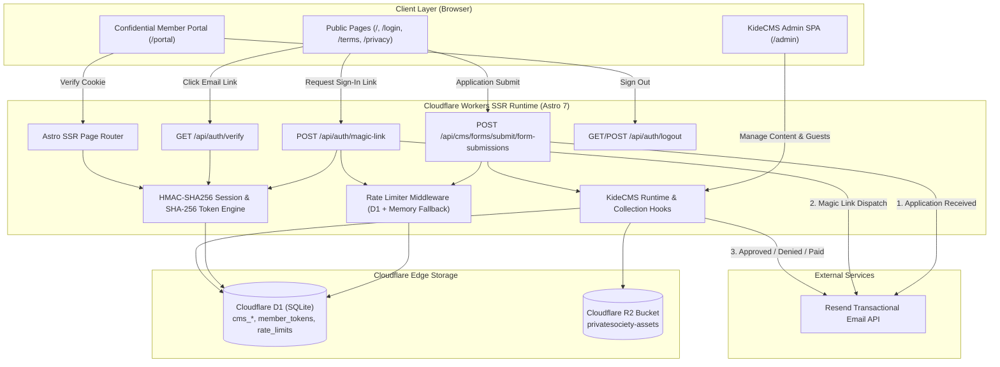
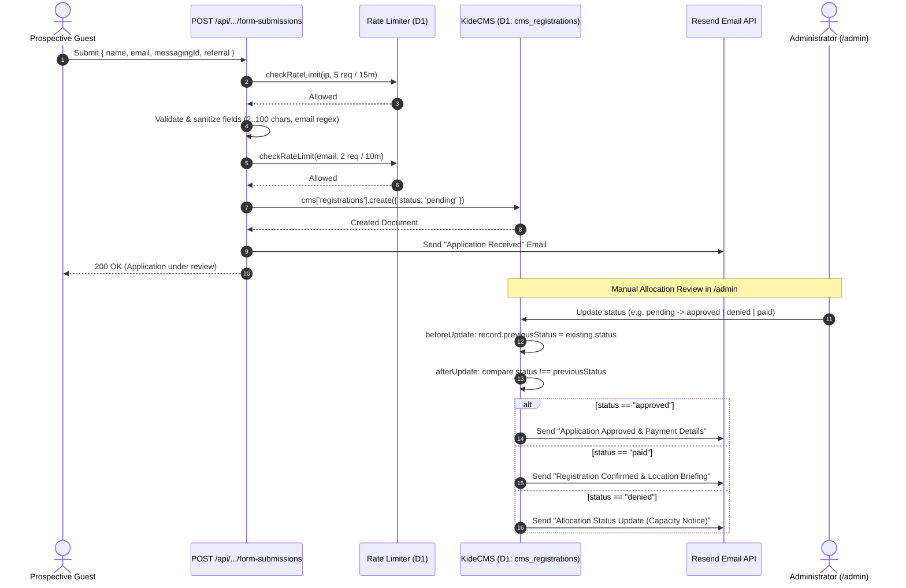
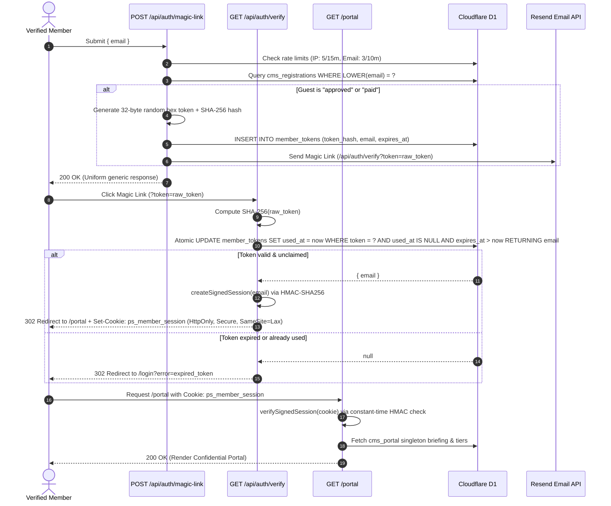
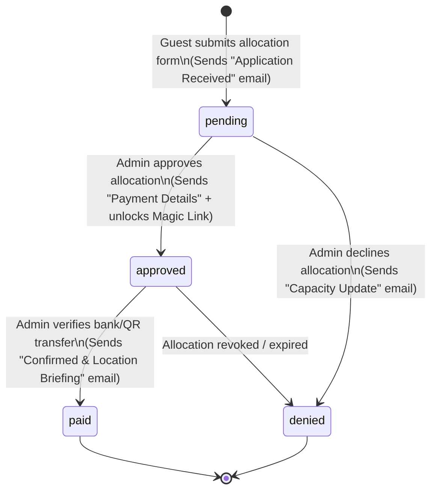
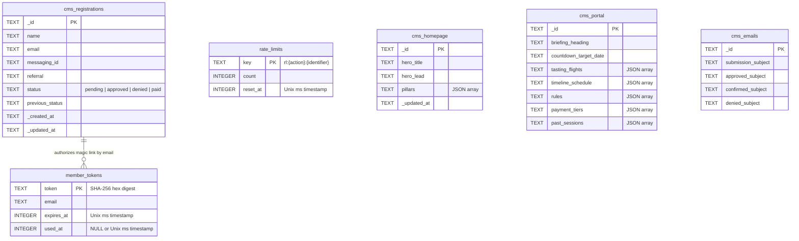

# System Architecture — Private Society

**Private Society** is an invitation-only gastronomical and viticultural assembly platform built on **Astro 7 SSR**, **Cloudflare Workers**, **Cloudflare D1 (SQLite)**, **Cloudflare R2**, **KideCMS**, and **Resend**.

It serves a public allocation request portal, a passwordless cryptographic member portal (`/portal`) with live assembly briefings, an embedded administrative CMS (`/admin`), and automated transactional email dispatches.

---

## 1. Architectural Principles

The system is engineered around six core principles prioritized by operational criticality:

1. **Correctness**: State transitions (guest application $\rightarrow$ review $\rightarrow$ payment $\rightarrow$ confirmation) are deterministic. Email dispatches trigger strictly on verified state transitions (`beforeUpdate` / `afterUpdate` hooks) with idempotent suppression on repeat saves.
2. **Safety & Zero-Trust Security**:
   - **Passwordless Magic Links**: One-time 256-bit random tokens are hashed with **SHA-256** at rest in D1 and consumed via a single atomic `UPDATE ... RETURNING` query to prevent race conditions and replay attacks.
   - **Stateless Cryptographic Sessions**: Member portal sessions (`ps_member_session`) are signed with **HMAC-SHA256** (`Web Crypto API`), enforcing constant-time signature verification and automatic expiration.
   - **Strict Output Escaping**: All user-supplied fields (`name`, `email`, `referral`, `messagingId`) pass through `escapeHtml()` before rendering into HTML email templates or SSR views.
3. **Resilience Under Load**:
   - **Edge-First Execution**: Runs globally on Cloudflare Workers close to users.
   - **Zero-DDL Hot Paths**: Schema definitions live strictly in `schema.sql` migrations; hot API routes execute indexed point lookups and atomic writes.
   - **Dual-Layer Rate Limiting**: Protects public endpoints per-IP and per-email in D1 with opportunistic retention cleanup and automatic in-memory fallback if D1 is unreachable.
4. **Testability**: Core security primitives, HTML escaping, email template rendering, payload validation, rate limiting, and CMS status transition hooks are verified via automated Vitest suites (`tests/`).
5. **Performance**: Zero unnecessary client-side JavaScript bundles on content pages, self-hosted `woff2` subset fonts with `font-display: swap`, and inline CSS delivery.
6. **Lean Footprint**: Minimal dependency tree with zero orphaned adapters, dead layouts, or unused client libraries.

---

## 2. High-Level System Architecture



---

## 3. Core Data Flows & Sequence Diagrams

### 3.1. Guest Registration & Admin Status Transition Flow

When a prospective guest requests an allocation on the homepage, the request is rate-limited, validated, stored in D1, and acknowledged via email. When an administrator updates the guest's status in `/admin`, collection lifecycle hooks automatically dispatch the corresponding transactional email.



### 3.2. Passwordless Magic Link & Portal Authentication Flow

Access to `/portal` is restricted to guests whose registration status is `approved` or `paid`. Enumeration resistance ensures `/api/auth/magic-link` returns an identical `200 OK` message regardless of whether an email is on the guest list.



### 3.3. Guest Allocation State Machine



---

## 4. Database Architecture (Cloudflare D1)

All persistent data resides in a single Cloudflare D1 SQLite database (`privatesociety-db`), defined declaratively in [`schema.sql`](file:///Users/robinsehnalik/dev/websites/privatesociety/schema.sql).



### Table Categories

| Table Name | Role | Access Pattern |
| :--- | :--- | :--- |
| `cms_homepage`, `cms_portal`, `cms_terms`, `cms_privacy`, `cms_emails` | **Content Singletons**: Store editable page copy, JSON structured blocks (menus, schedules, payment tiers, rules), and email templates. | Read on SSR page render / email dispatch; updated via `/admin` with `afterRead` fallback defaults. |
| `cms_registrations`, `cms_form_submissions` | **Guest Applications**: Track applicant identity, encrypted messaging handle, vouching member referral, and allocation status. | Created via `POST /api/cms/forms/submit/form-submissions`; managed in `/admin`. |
| `member_tokens` | **Passwordless Auth**: Stores SHA-256 token digests with 15-minute TTLs and single-use `used_at` timestamps. | Inserted on `/api/auth/magic-link`; atomically claimed on `/api/auth/verify`. |
| `rate_limits` | **Edge Flood Protection**: Tracks request counters per IP and email window (`reset_at` indexed via `rate_limits_reset_at_idx`). | Checked/updated on form and auth endpoints; expired rows purged opportunistically. |
| `cms_users`, `cms_sessions`, `cms_assets`, `cms_audit_log`, `cms_outbox`, `cms_locks` | **KideCMS Internal Tables**: Admin authentication, R2 media metadata, audit logging, and document locking. | Managed by `@kidecms/core`. |

---

## 5. Repository File Map

```text
privatesociety/
├── astro.config.mjs               # Astro 7 SSR configuration, Cloudflare adapter, KideCMS & Tailwind v4 plugins
├── wrangler.toml                  # Cloudflare Worker bindings: ASSETS, CMS_DB (D1), CMS_ASSETS (R2), custom domain
├── schema.sql                     # Authoritative D1 SQLite schema migration (CMS collections, tokens, rate limits)
├── package.json                   # Project dependencies and npm scripts (dev, build, preview, test)
├── tsconfig.json                  # Strict TypeScript configuration
├── .env.example                   # Template for required runtime secrets (RESEND_API_KEY, SESSION_SECRET)
│
├── public/                        # Static edge-cached assets served directly by Cloudflare ASSETS binding
│   ├── _headers                   # HTTP security & caching headers for static assets
│   ├── fonts/                     # Self-hosted WOFF2 fonts (Dela Gothic One & Space Mono, latin & latin-ext)
│   ├── images/                    # Optimized AVIF/WebP/JPG photography, QR codes, and OpenGraph preview
│   └── scripts/
│       └── portal.js              # Client-side interactivity for /portal (countdown timer, tier tabs, archive modals)
│
├── scripts/
│   └── seed-admin.ts              # CLI utility to seed initial KideCMS administrator credentials
│
├── src/
│   ├── site-config.yml            # Global site identity ("PRIVATE SOCIETY", description, timezone, locale)
│   ├── content.config.ts          # Astro content collection loader for site-config.yml and socials.yml
│   ├── env.d.ts                   # TypeScript environment declarations
│   │
│   ├── cms/                       # Headless & Embedded CMS Configuration
│   │   ├── cms.config.ts          # KideCMS singletons (homepage, portal, terms, privacy, emails) & registrations hooks
│   │   └── runtime.ts             # Cloudflare D1 + R2 runtime wiring for @kidecms/core
│   │
│   ├── components/                # Astro UI Components
│   │   ├── BaseHead.astro         # Document <head>, canonical URLs, OpenGraph & Twitter SEO metadata
│   │   ├── Header.astro           # Brutalist top navigation bar with status indicator & CTA buttons
│   │   ├── HeaderLink.astro       # Active-aware navigation link helper
│   │   ├── Footer.astro           # Brutalist footer with sitemap, legal links, and confidentiality badge
│   │   ├── RegistrationForm.astro # Guest allocation request card & form markup
│   │   ├── Countdown.astro        # Live assembly countdown display widget for the member portal
│   │   ├── TastingFlightCard.astro# Gastronomical course & pairing card component
│   │   ├── PaymentTierCard.astro  # Interactive QR & bank transfer payment tier selector
│   │   ├── PastSessionCard.astro  # Expandable archive card for past assemblies
│   │   ├── BlockRenderer.astro    # Dynamic CMS block renderer
│   │   └── ContentRenderer.astro  # Rich text / structured content renderer
│   │
│   ├── emails/                    # Brutalist HTML Transactional Email Renderers
│   │   ├── submission-received.ts # Template 1: Dispatched immediately upon guest registration
│   │   ├── payment-details.ts     # Template 2: Dispatched when status transitions to "approved"
│   │   ├── location-details.ts    # Template 3: Dispatched when status transitions to "paid"
│   │   ├── denial-notice.ts       # Template 4: Dispatched when status transitions to "denied"
│   │   └── magic-link.ts          # Template 5: One-time cryptographic sign-in link email
│   │
│   ├── i18n/
│   │   └── translations.ts        # Default English copy dictionary and TypeScript schema
│   │
│   ├── layouts/
│   │   ├── BaseLayout.astro       # Master shell: HTML document, BaseHead, Header, <main>, and Footer
│   │   └── PageLayout.astro       # Standard content page wrapper
│   │
│   ├── lib/                       # Core Server & Security Utilities
│   │   ├── session.ts             # HMAC-SHA256 cookie signing/verification & SHA-256 token hashing
│   │   ├── rate-limit.ts          # D1 sliding-window rate limiter with opportunistic purge & memory fallback
│   │   ├── resend.ts              # Resend API client wrapper with dev console fallback
│   │   ├── resolve-template.ts    # Sanitizes CMS email fields and filters raw column placeholder strings
│   │   ├── escape.ts              # HTML entity escaping (&, <, >, ", ') against XSS injection
│   │   └── config.ts              # Environment helper utilities
│   │
│   ├── pages/                     # Astro File-Based SSR Routes & API Endpoints
│   │   ├── index.astro            # Public landing page (Hero, Philosophy, Session #2 Dispatch, Pillars, Registration)
│   │   ├── login.astro            # Passwordless member sign-in page (Magic Link request UI)
│   │   ├── portal.astro           # Authenticated member portal (Briefing, Menu, Schedule, Rules, Payment, Archives)
│   │   ├── terms.astro            # Terms of Service & Guest Code of Conduct
│   │   ├── privacy.astro          # Privacy Policy & Zero-Retention Cryptographic Protocols
│   │   ├── 404.astro              # Custom brutalist 404 error page
│   │   ├── robots.txt.ts          # Dynamic crawler directives (/admin, /portal, /api disallowed)
│   │   ├── sitemap.xml.ts         # Dynamic XML sitemap generator for public routes
│   │   ├── emails/
│   │   │   └── preview.astro      # Local/admin visual preview harness for all 5 transactional emails
│   │   └── api/
│   │       ├── auth/
│   │       │   ├── magic-link.ts  # POST: Validates member eligibility, generates token, sends Magic Link
│   │       │   ├── verify.ts      # GET: Atomically claims token, sets signed session cookie, redirects to /portal
│   │       │   └── logout.ts      # GET/POST: Clears ps_member_session cookie and redirects to /login
│   │       └── cms/
│   │           └── forms/submit/
│   │               └── form-submissions.ts # POST: Rate-limited guest application intake & confirmation email
│   │
│   ├── scripts/
│   │   └── registration.ts        # Client-side progressive enhancement for #cms-registration-form submission
│   │
│   ├── styles/
│   │   ├── global.css             # Tailwind v4 theme tokens, @font-face declarations, halftone background, button styles
│   │   └── admin.css              # Custom styling overrides for KideCMS admin interface
│   │
│   └── utils/
│       ├── consts.ts              # Site metadata accessor (getSite) with fallback defaults
│       └── slugify.ts             # URL slug normalization helper
│
└── tests/                         # Automated Vitest Verification Suite
    ├── session.test.ts            # HMAC-SHA256 session signing, tampering detection, expiration, custom secrets
    ├── rate-limit.test.ts         # Cloudflare IP header extraction and flood blocking thresholds
    ├── emails.test.ts             # All 5 email templates, XSS escaping, placeholder filtering, underscore preservation
    ├── escape.test.ts             # HTML entity escaping edge cases
    ├── registration-validation.test.ts # Registration payload boundary validation and normalization
    └── status-transitions.test.ts # CMS status hook transitions (approved, denied, paid, no-op suppression)
```

---

## 6. Security & Cryptographic Architecture

### 6.1. Session Cookie Integrity (`src/lib/session.ts`)
- **Format**: `base64url(email).timestamp.base64url(hmac_sha256_signature)`
- **Secret Resolution**: Reads `SESSION_SECRET` from Cloudflare Worker environment bindings (`getCfEnv()`). Throws a hard error in production if unconfigured; permits a deterministic fallback only in local dev/test environments.
- **Constant-Time Verification**: `verifySignedSession()` uses `crypto.subtle.verify('HMAC', ...)` inside the Web Crypto API to prevent timing side-channel attacks, validating both signature authenticity and the 7-day maximum age window.
- **Cookie Flags**: `HttpOnly`, `Secure` (on HTTPS), `SameSite=Lax`, `Path=/`.

### 6.2. Atomic One-Time Magic Links (`src/pages/api/auth/verify.ts`)
- **At-Rest Hashing**: Raw 32-byte random hex tokens exist only in the user's email link. D1 stores `SHA-256(token)`.
- **Atomic Claiming**: Token verification executes a single SQLite statement:
  ```sql
  UPDATE member_tokens
  SET used_at = ?
  WHERE token = ? AND (used_at IS NULL OR used_at = 0) AND expires_at > ?
  RETURNING email
  ```
  This guarantees that concurrent requests racing with the same token cannot both succeed—only the first request matches the `WHERE` clause and receives the `email` row.

### 6.3. Edge Rate Limiting (`src/lib/rate-limit.ts`)
- **Client IP Resolution**: Extracts the true client IP prioritizing `cf-connecting-ip` $\rightarrow$ `x-real-ip` $\rightarrow$ first hop of `x-forwarded-for`.
- **Thresholds**:
  - Guest Registration (`POST /api/cms/forms/submit/form-submissions`): **5 req / 15 min per IP**, **2 req / 10 min per email**.
  - Magic Link Request (`POST /api/auth/magic-link`): **5 req / 15 min per IP**, **3 req / 10 min per email**.
- **Self-Cleaning Storage**: Whenever a new rate-limit window is initialized, an opportunistic `DELETE FROM rate_limits WHERE reset_at < ?` purges expired keys using the `rate_limits_reset_at_idx` index.

---

## 7. Design System & Visual Styling

Private Society implements a **Neo-Brutalist Archival Dispatch** aesthetic across both web pages and HTML emails.

### 7.1. Color Palette & Theme Tokens (`src/styles/global.css`)

| Token | Hex | Usage |
| :--- | :--- | :--- |
| `--color-ink` | `#0d0d0d` | Primary typography, 2px–3px structural borders, hard offset drop shadows (`3px 3px 0 #0d0d0d`). |
| `--color-paper` | `#ede5d5` | Warm archival paper background with a `14px` radial halftone dot grid. |
| `--color-surface` | `#f4eee2` | Elevated card surfaces, document panels, and input backgrounds. |
| `--color-pink` / `--color-accent` | `#f29bb4` | High-contrast brutalist call-to-action buttons, status pills, and active highlights. |
| `--color-crimson` | `#7a1f28` | Hover states, confidential warning banners, and secondary accents. |

### 7.2. Typography

- **Display Headings (`--font-display`)**: **Dela Gothic One** — heavy, uppercase, tightly tracked (`-0.02em`) brutalist display type used for section titles and hero headlines.
- **Technical & Body Copy (`--font-mono`)**: **Space Mono** (400 & 700) — monospace type used for dispatch metadata, coordinates, form inputs, and body copy.
- **Font Loading Strategy**: Self-hosted `woff2` subsets (`latin` and `latin-ext`) served from `/fonts/` with `font-display: swap` to eliminate external Google Fonts network requests and layout shifts.

### 7.3. Transactional Email Design (`src/emails/*.ts`)
All five transactional emails are rendered as standalone, table-based HTML documents with inline styles matching the brutalist web aesthetic (`#ede5d5` paper outer frame, `#f4eee2` card container, `3px solid #0d0d0d` borders, `6px 6px 0px #0d0d0d` hard shadows, and `Courier New` / `Space Mono` typography) to guarantee visual fidelity across Apple Mail, Gmail, ProtonMail, and Outlook.

---

---

## 8. Frontend Performance & Core Web Vitals

Private Society eliminates client-side JavaScript framework overhead on public routes. Pages are pre-rendered into static HTML with zero virtual DOM hydration, while critical styling is inlined directly into `<head>`.

### 8.1. Multi-Region Production Benchmarks (Lighthouse 13.5.0 Desktop)

Audited across global edge testing locations:

| Test Location | Performance | Accessibility | Best Practices | SEO | FCP | LCP | TTI | TBT | CLS |
| :--- | :---: | :---: | :---: | :---: | :---: | :---: | :---: | :---: | :---: |
| **Germany** | **100** | **100** | **100** | **100** | 306ms | 346ms | 346ms | 0ms | 0.02 |
| **Finland** | **100** | **100** | **100** | **100** | 307ms | 342ms | 342ms | 0ms | 0.00 |
| **US East** | **100** | **100** | **100** | **100** | 494ms | 494ms | 494ms | 0ms | 0.02 |

### 8.2. Architectural Performance Drivers

- **Zero Total Blocking Time (TBT = 0ms):** Public routes load without heavy monolithic framework runtimes (e.g., React or Vue client bundles). Buttons, links, and form inputs are immediately interactive upon first paint.
- **Sub-500ms Global LCP:** `inlineStylesheets: "always"` embeds LightningCSS-minified styles directly into the document `<head>`, eliminating render-blocking CSS network roundtrips. Combined with Cloudflare Anycast edge caching, First Contentful Paint completes in $\le 307\text{ms}$ in Europe and $\le 494\text{ms}$ in North America.
- **Layout Shift Elimination (CLS $\le$ 0.02):** Monospace tabular numbers (`tabular-nums`) and static layout geometry prevent layout shifts during countdown intervals. Editorial photography slots maintain rigid aspect-ratio wrappers.

### 8.3. Technical SEO, Indexation & Structured Data

Search engine discovery and machine-readability are engineered for early domain authority:
- **Schema.org Linked `@graph`:** Outputs connected `Organization` and `FoodEvent` schemas on public indexable pages.
- **Indexation Discipline:** Strictly disallows crawl waste and soft-404 indexation by returning `noindex, nofollow` on `/portal`, `/login`, `/emails/preview`, and `/404`.
- **Dynamic XML Sitemap:** Emits real `_updatedAt` timestamps queried directly from KideCMS singletons.

For the exhaustive SEO audit and optimization strategy, see [`seo.md`](seo.md).

---

## 9. Showcase Components & Sanitized Patterns

To demonstrate production engineering patterns without exposing proprietary client credentials or private business rules, the following sanitized implementations are available in this repository:

1. **Member Vetting & Admission Form ([`components/SanitizedRegistrationForm.astro`](components/SanitizedRegistrationForm.astro)):**
   - High-contrast brutalist visual design system (`#ede5d5` parchment background, 2px `#0d0d0d` borders, offset drop shadows `6px 6px 0 #0d0d0d`).
   - Ingests and pre-fills URL query parameters (`?ref=CODE`) for sponsored member referrals.
   - Enforces alternative communication handles (Signal, Telegram, PGP).
   - Multi-phase asynchronous state machine with loading spinners and manual review confirmation text.

2. **Session Countdown Timer ([`components/SanitizedCountdown.astro`](components/SanitizedCountdown.astro)):**
   - Standalone vanilla JavaScript timer interval without external library dependencies.
   - Tabular monospace numbers preventing horizontal and vertical layout shifts.

3. **Client Vetting Pattern ([`examples/sanitized-ui-pattern.ts`](examples/sanitized-ui-pattern.ts)):**
   - Independent TypeScript module demonstrating URL referral parameter parsing, identity handle validation, and async error recovery.

---

## 10. Development, Testing & Deployment

### Local Development
```bash
# Install dependencies
npm install

# Start local Astro + Cloudflare Worker dev server
npm run dev

# Run automated Vitest verification suite
npm test
```

### Database Migration & Production Deployment
```bash
# Apply D1 schema migrations locally or remotely
npx wrangler d1 execute privatesociety-db --file=./schema.sql --remote

# Configure required production secrets in Cloudflare Workers
npx wrangler secret put SESSION_SECRET
npx wrangler secret put RESEND_API_KEY

# Build SSR worker bundle
ASTRO_TELEMETRY_DISABLED=1 npm run build
```

