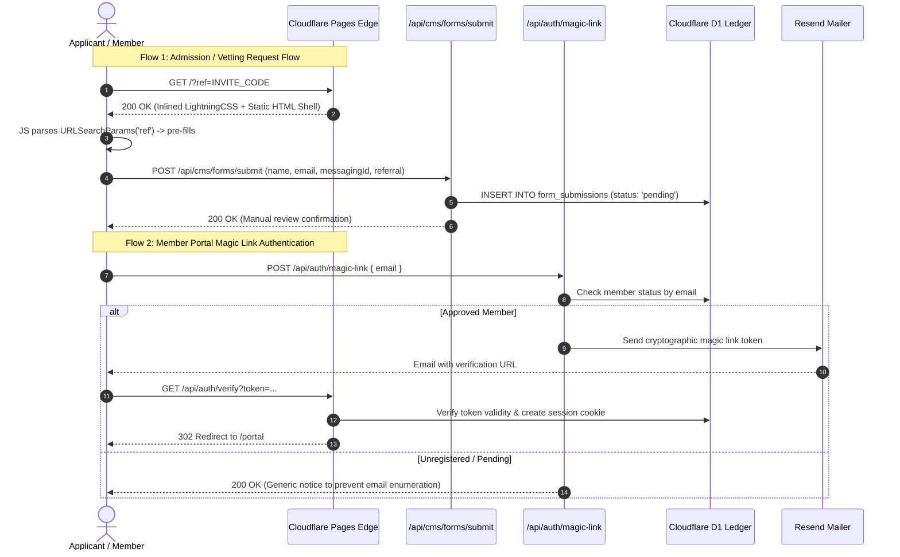

# Frontend Architecture & Engineering Decisions

This document outlines the frontend architectural principles, rendering strategies, performance budgets, and UI engineering decisions implemented for **privatesocietylab.com** (Private Society Lab).

---

## Client Interaction & Authentication Flow

---

## Architectural Principles

### 1. Zero-Framework Runtime Baseline & Astro v7
- **Static Page Output:** The public manifesto, tasting session archives, and admission overview are pre-rendered into static HTML at build time via Astro v7. Public routes run without a client-side JavaScript framework runtime.
- **Progressive Client Script Modules:** Interactive components (the referral-aware admission form and the session countdown timer) use lightweight vanilla TypeScript modules directly bundled by Astro.
- **Inlined Critical Stylesheets:** With `build: { inlineStylesheets: "always" }`, compiled styles are inlined directly into document `<head>`, eliminating network round-trips for external CSS files.

### 2. Core Web Vitals Performance Budget

Rather than relying on unverified synthetic scores, the frontend architecture enforces concrete constraints to satisfy Google Core Web Vitals thresholds:

| Metric | Target Budget | Architectural Enforcement Strategy |
| :--- | :--- | :--- |
| **LCP** (Largest Contentful Paint) | $\le$ 2.5s | <ul><li>Inlined critical stylesheets via `inlineStylesheets: "always"` eliminate render-blocking CSS requests</li><li>LightningCSS minification optimizes the CSS footprint during Vite compilation</li><li>Edge caching on Cloudflare Pages Anycast network ensures low TTFB</li></ul> |
| **INP** (Interaction to Next Paint) | $\le$ 200ms | <ul><li>Zero hydration lag: all form elements and action buttons are immediately interactive on initial paint</li><li>No monolithic SPA runtime on the main thread</li><li>Form handlers use lightweight vanilla event listeners and non-blocking asynchronous dispatch</li></ul> |
| **CLS** (Cumulative Layout Shift) | $\le$ 0.1 | <ul><li>Countdown timer uses tabular numbers (`tabular-nums`) and monospace typography to prevent text shifts on second changes</li><li>Editorial photography slots reserve fixed CSS aspect ratios</li><li>Font fallback metrics are aligned to minimize reflow during webfont swap</li></ul> |

---

## Production Component Architecture Showcases

Sanitized versions of the core UI components are available directly in this repository:

1. **Member Vetting & Admission Form ([`components/SanitizedRegistrationForm.astro`](../components/SanitizedRegistrationForm.astro)):**
   - High-contrast visual design system (warm background, sharp borders, offset shadows).
   - Ingests and pre-fills URL query parameters (`?ref=CODE`) for sponsored member referrals.
   - Enforces alternative communication handles (Signal, Telegram, PGP).
   - Multi-phase asynchronous state machine with loading spinners and manual review confirmation text.

2. **Session Countdown Timer ([`components/SanitizedCountdown.astro`](../components/SanitizedCountdown.astro)):**
   - Standalone vanilla JavaScript timer interval without external library dependencies.
   - Tabular monospace numbers preventing horizontal and vertical layout shifts.

3. **Client Vetting Pattern ([`examples/sanitized-ui-pattern.ts`](../examples/sanitized-ui-pattern.ts)):**
   - Independent TypeScript module demonstrating URL referral parameter parsing, identity handle validation, and async error recovery.

---

## Design System & Accessibility

- **High-Contrast Monochromatic UI:** Clear typographic hierarchy optimized for dark-mode and high-contrast environments.
- **Tactile UI Elements:** Crisp borders with offset drop shadows (`box-shadow: 6px 6px 0 #0d0d0d`) and hover transitions (`translate(-3px, -3px)`).
- **Accessibility:** Full keyboard navigability and WCAG 2.1 AA compliant contrast ratios across all text elements.
