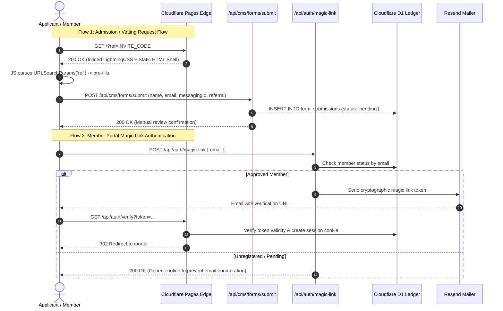

# Frontend Architecture & Engineering Decisions

> [!NOTE]
> This document specifically details the **client-side engineering, responsive layout patterns, Core Web Vitals optimizations, and sanitized UI component showcases**.
> For the comprehensive end-to-end edge system architecture (Cloudflare Workers runtime, D1 SQLite schema, HMAC-SHA256 session cryptography, atomic magic link authentication, and automated Vitest suites), see the master **[`System Architecture Specification (architecture.md)`](../architecture.md)**.

This document outlines the frontend architectural principles, rendering strategies, performance budgets, and UI engineering decisions implemented for **privatesocietylab.com** (Private Society Lab).

---

## Architectural Context & Separation of Concerns

The application architecture is structured into two complementary layers:

1. **System & Edge Layer ([`architecture.md`](../architecture.md)):**
   - Cloudflare Workers SSR engine running Astro 7.
   - Cloudflare D1 SQLite database (`schema.sql`) and Cloudflare R2 asset storage.
   - Serverless authentication (`/api/auth/magic-link`, `/api/auth/verify`, `/api/auth/logout`) with HMAC-SHA256 session integrity.
   - Transactional email dispatch pipelines via Resend and KideCMS status transition hooks.

2. **Frontend & Client Viewport Layer (This Document):**
   - Zero-framework baseline shipping pre-rendered HTML to the browser with zero client hydration delay.
   - Vite + LightningCSS compilation pipeline with document-inlined critical stylesheets (`inlineStylesheets: "always"`).
   - Defensive, zero-dependency client scripts for invitation vetting and real-time interval counters.
   - Mobile-first responsive layouts maintaining strict WCAG 2.1 AA contrast and zero layout shifts.

---

## Client Interaction & Authentication Lifecycle

*(For extended sequence diagrams detailing the admin status lifecycle and cryptographic token hashing, refer to [`architecture.md § 3`](../architecture.md#3-core-data-flows--sequence-diagrams).)*

---

## Architectural Principles

### 1. Zero-Framework Runtime Baseline & Astro v7
- **Static Page Output:** The public manifesto, tasting session archives, and admission overview are pre-rendered into static HTML at build time via Astro v7. Public routes run without a client-side JavaScript framework runtime.
- **Progressive Client Script Modules:** Interactive components (the referral-aware admission form and the session countdown timer) use lightweight vanilla TypeScript modules directly bundled by Astro.
- **Inlined Critical Stylesheets:** With `build: { inlineStylesheets: "always" }`, compiled styles are inlined directly into document `<head>`, eliminating network round-trips for external CSS files.

### 2. Multi-Region Core Web Vitals Audit Data

Production benchmarks audited via **Lighthouse 13.5.0** (Desktop) across global test locations:

| Test Location | Performance | Accessibility | Best Practices | SEO | FCP | LCP | TTI | TBT | CLS |
| :--- | :---: | :---: | :---: | :---: | :---: | :---: | :---: | :---: | :---: |
| **Germany** | **100** | **100** | **100** | **100** | 306ms | 346ms | 346ms | 0ms | 0.02 |
| **Finland** | **100** | **100** | **100** | **100** | 307ms | 342ms | 342ms | 0ms | 0.00 |
| **US East** | **100** | **100** | **100** | **100** | 494ms | 494ms | 494ms | 0ms | 0.02 |

#### Architectural Analysis:
* **Perfect 100/100/100/100 Category Scores:** Clean HTML semantics, WCAG AA compliance, and zero runtime overhead yield straight 100s across all global audit points.
* **TBT = 0ms:** Completely avoiding client-side virtual DOM hydration leaves the main thread entirely clear for user interaction.
* **Sub-500ms Global LCP:** Through Vite + LightningCSS compilation and inlined critical styling, Largest Contentful Paint completes between 342ms and 494ms worldwide.
* **CLS $\le$ 0.02:** Monospace tabular numbers (`tabular-nums`) and static layout geometry prevent layout shifts during countdown intervals.

---

## Production Component Architecture Showcases

Sanitized versions of the core UI components are available directly in this repository:

1. **Member Vetting & Admission Form ([`components/SanitizedRegistrationForm.astro`](../components/SanitizedRegistrationForm.astro)):**
   - High-contrast visual design system (warm background, sharp borders, offset shadows).
   - Ingests and pre-fills URL query parameters (`?ref=CODE`) for sponsored member referrals.
   - Enforces alternative communication handles (Signal, Telegram, PGP).
   - Multi-phase asynchronous state machine with loading spinners and manual review confirmation text.

2. **Session Countdown Timer ([`components/SanitizedCountdown.astro`](../components/SanitizedCountdown.astro)):**
   - Standalone vanilla JavaScript timer interval without external library dependencies.
   - Tabular monospace numbers preventing horizontal and vertical layout shifts.

3. **Client Vetting Pattern ([`examples/sanitized-ui-pattern.ts`](../examples/sanitized-ui-pattern.ts)):**
   - Independent TypeScript module demonstrating URL referral parameter parsing, identity handle validation, and async error recovery.

---

## Design System & Accessibility

For the exhaustive design tokens table and typography breakdown, see [`architecture.md § 7`](../architecture.md#7-design-system--visual-styling).

- **High-Contrast Monochromatic UI:** Clear typographic hierarchy using `Dela Gothic One` for headings and `Space Mono` for metadata, optimized for dark-mode and high-contrast environments.
- **Tactile UI Elements:** Crisp borders (`2px solid #0d0d0d`) with offset drop shadows (`box-shadow: 6px 6px 0 #0d0d0d`) and hover transitions (`translate(-3px, -3px)`).
- **Self-Hosted Font Subsetting:** Custom WOFF2 font subsets served locally with `font-display: swap`, avoiding external Google Fonts blocking calls.
- **Accessibility:** Full keyboard navigability and WCAG 2.1 AA compliant contrast ratios across all text elements (audited at 100/100).
